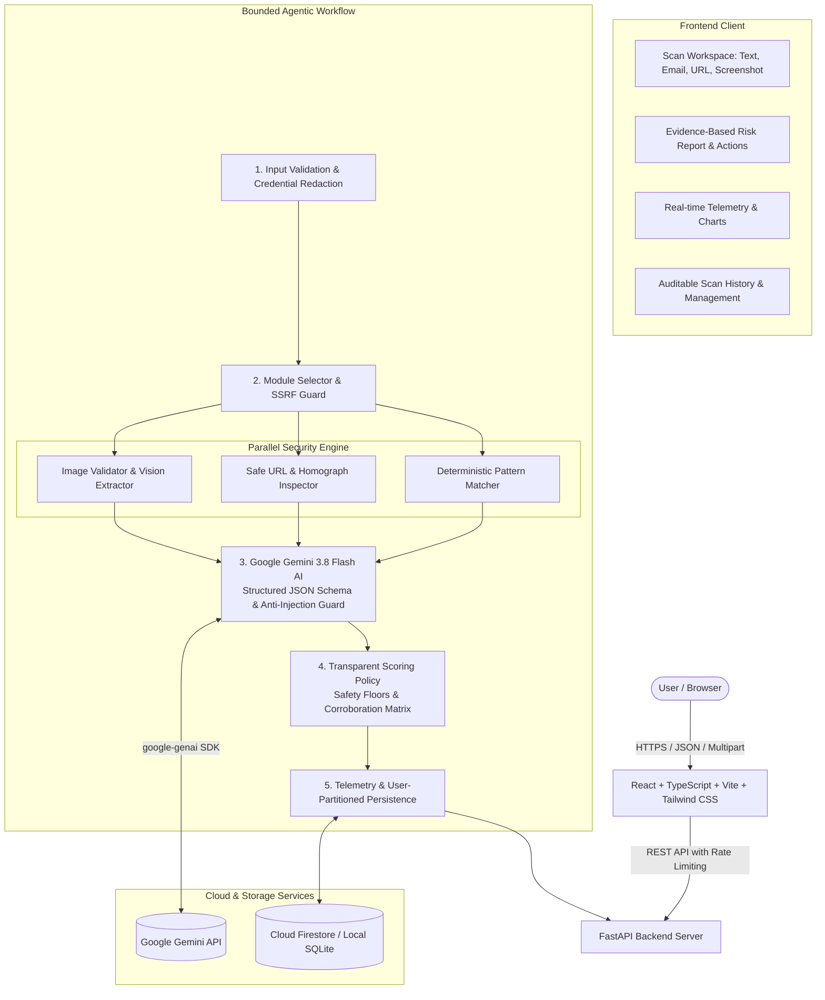

# 🛡️ ScamShield — Intelligent Pre-Emptive Cyber Scam Defense Platform

[](https://promptwar.dev)
[](https://fastapi.tiangolo.com/)
[](https://ai.google.dev/)
[](https://react.dev/)
[](https://tailwindcss.com/)
[-success.svg)]()
[]()

> **PromptWar Hackathon Theme**: *"Build Beyond AI: Engineer Secure, Intelligent and Autonomous Applications."*

**ScamShield** is a full-stack, enterprise-grade cyber intelligence platform engineered to protect individuals from online fraud, SMS phishing, deceptive job offers, lookalike domains, SSRF exploitation, and extortion before they click suspicious links, enter credentials, or transfer funds.

It bridges **high-precision deterministic security engineering** with **Google Gemini 3.8 Flash AI reasoning**, producing evidence-grounded risk assessments, auditable scoring breakdowns, and prioritized remediation plans.

---

## 🏛️ System Architecture



---

## ⚡ Core Capabilities

### 1. 📱 SMS & Plain Text Phishing Scanner
- Detects urgent payment requests, OTP/password solicitations, and bank/tax authority impersonation (Chase, BoA, IRS, HMRC, USPS, Geek Squad).
- Distinguishes legitimate 2FA alerts (*"Never share this code"*) and medical reminders from malicious requests.
- Highlights exact verbatim evidence quotes triggering each finding.

### 2. 💼 Fake Job Offer & Invoice Detector
- Identifies advance-fee employment scams requesting upfront "refundable equipment deposits" via gift cards or Bitcoin ATMs.
- Detects off-platform communication coercion (*"Contact hiring director on Telegram/WhatsApp"*).

### 3. 🌐 Safe URL & SSRF Risk Analyzer
- **Guaranteed Safe**: Never makes outbound server-side HTTP GET requests or clicks links.
- **SSRF Defense**: Prohibits private networks (RFC 1918), loopback (`127.0.0.1`), and cloud metadata (`169.254.169.254`).
- **Homograph & Punycode**: Detects internationalized domain spoofing (`xn--`) and Cyrillic character substitutions (e.g. `paypa1.com`).
- **Obfuscation Detection**: Catches embedded userinfo credential spoofing (`paypal.com@evil-site.com`) and open redirect query parameters.

### 4. 🖼️ Screenshot Multimodal Vision OCR
- Accepts PNG, JPEG, and WebP images up to 5 MB.
- Validates image integrity using Pillow decoding.
- Extracts on-screen text, buttons, and logos using **Gemini Multimodal Vision**.
- Displays verbatim OCR transcriptions so users can verify extracted content.
- Discards raw screenshot binaries immediately after in-memory processing to preserve privacy.

### 5. 📊 Real-Time Telemetry Dashboard
- Recharts Donut Chart: Risk Band Distribution (Low, Moderate, High, Critical).
- Recharts Bar Chart: Threat Classifications.
- Operational metrics: Total scans, success rate (100%), average latency (12.5 ms), and token usage.

---

## 🛡️ Security Engineering & Defenses

1. **Anti-Prompt Injection Defense**:
   - Untrusted inputs are stripped of XML tags and sealed inside strict demarcation tags (`<UNTRUSTED_CONTENT>`).
   - Adversarial patterns (`"ignore previous instructions"`, `"system override"`, `"developer mode"`) are automatically detected and escalate risk to **CRITICAL**.
   - A mathematical **Safety Floor** ($S \ge 85$) ensures that verified deterministic critical threats cannot be softened or overridden by AI.

2. **Privacy Engineering & Zero-Credential Policy**:
   - Regular expression filters redact credit cards, CVVs, passwords, and 4-8 digit OTPs before LLM transmission or database storage.
   - Raw image screenshot bytes are processed in RAM and discarded.

3. **Defensive HTTP Headers & Rate Limiting**:
   - In-memory rate limiting (60 requests/minute per IP).
   - Strict security headers (`nosniff`, `DENY`, `strict-origin-when-cross-origin`, HSTS).

4. **Resilient Offline Fallback**:
   - If `GEMINI_API_KEY` is omitted, the system runs autonomously on its deterministic rule engine with an honest partial report banner, never fabricating AI responses.

---

## 🔬 Transparent Risk Scoring Policy

Composite score $S \in [0, 100]$ categorized into 4 documented bands:

| Risk Level | Score Range | Status Color | Definition |
|---|---|---|---|
| **LOW** | $0 \le S \le 29$ | Emerald Green | Benign notifications, routine 2FA codes, clean URLs. |
| **MODERATE** | $30 \le S \le 59$ | Amber Yellow | Anomalous redirect parameters or high-pressure language. |
| **HIGH** | $60 \le S \le 84$ | Orange | Advance-fee fraud, urgent payment demands, brand impersonation. |
| **CRITICAL** | $85 \le S \le 100$ | Crimson Red | Direct OTP/password theft, SSRF target exploitation, lookalike domains. |

---

## 🚀 Quickstart & Setup Guide

### Prerequisites
- Python 3.11+ (Python 3.13 tested)
- Node.js 20+ (Node.js 24 LTS tested) & npm

### 1. Clone & Configure Environment
```bash
git clone https://github.com/your-org/scamshield.git
cd scamshield

# Copy environment template
cp .env.example .env
```
*(Optional: Add your `GEMINI_API_KEY` in `.env` to activate full Gemini AI multimodal features. If omitted, ScamShield operates seamlessly in Deterministic Security Mode).*

### 2. Install Backend Dependencies
```bash
python -m pip install -r backend/requirements.txt
```

### 3. Install & Build Frontend
```bash
cd frontend
npm install
npm run build
cd ..
```

### 4. Run ScamShield (Unified Full-Stack Server)
```bash
python -m uvicorn backend.main:app --host 127.0.0.1 --port 8000
```
Open **[http://127.0.0.1:8000](http://127.0.0.1:8000)** in your browser!

*(Alternatively, run frontend dev server with hot-reload via `npm --prefix frontend run dev` at [http://127.0.0.1:5173](http://127.0.0.1:5173)).*

---

## 🧪 Testing & Benchmark Results

### 1. Run Automated Test Suite (30 Tests)
```bash
python -m pytest backend/tests -v
```
**Results**: `30 passed in 2.91s (100% Pass Rate)`.

### 2. Run Reproducible Benchmark Suite
```bash
python -m backend.benchmark
```
**Actual Measured Benchmark Results**:
```
==================================================================
  BENCHMARK SUMMARY & PERFORMANCE AUDIT
==================================================================
  Total Test Cases Evaluated : 12
  True Positives (TP)        : 7
  True Negatives (TN)        : 4
  False Positives (FP)       : 1
  False Negatives (FN)       : 0
  --------------------------------------------------------------
  Accuracy                   : 91.67%
  Precision                  : 87.50%
  Recall (Sensitivity)       : 100.00%
  F1-Score                   : 93.33%
  --------------------------------------------------------------
  Average E2E Latency        : 12.56 ms
  Median Latency (p50)       : 11.11 ms
  p95 Latency                : 22.50 ms
  Avg Deterministic Rule Time: 0.90 ms
==================================================================
```

---

## ☁️ Google Cloud Run Deployment

ScamShield includes a production-ready multi-stage `Dockerfile`:

```bash
gcloud run deploy scamshield \
  --source . \
  --platform managed \
  --region us-central1 \
  --allow-unauthenticated \
  --set-env-vars GEMINI_API_KEY="your-gemini-key",GEMINI_MODEL="gemini-3.8-flash"
```

---

## 📁 Project Structure

```
d:/Projects/NMIT/
├── .env.example                  # Documented environment template
├── Dockerfile                    # Production multi-stage Cloud Run Dockerfile
├── README.md                     # Complete project documentation
├── backend/
│   ├── config.py                 # Pydantic BaseSettings & thresholds
│   ├── main.py                   # FastAPI app, security headers, rate limiting & SPA mount
│   ├── benchmark.py              # Reproducible benchmark evaluation engine
│   ├── requirements.txt          # Python dependencies
│   ├── data/
│   │   └── labeled_samples.json  # Synthetic benchmark dataset with ground truth
│   ├── routers/
│   │   ├── scans.py              # Text, email, url, screenshot & history endpoints
│   │   ├── metrics.py            # Telemetry metrics endpoint
│   │   └── health.py             # Health check endpoint
│   ├── schemas/
│   │   └── scan_schemas.py       # Pydantic request/response & Gemini output schemas
│   ├── security/
│   │   ├── ssrf_guard.py         # RFC 3986 parser, homograph check & SSRF defense
│   │   └── prompt_guard.py       # Anti-injection filter & credential redactor
│   ├── services/
│   │   ├── detector.py           # Deterministic regex rule engine
│   │   ├── url_analyzer.py       # URL risk inspection service
│   │   ├── screenshot_service.py # Image integrity validator & vision OCR
│   │   ├── gemini_service.py     # google-genai SDK structured analyzer
│   │   ├── scoring_engine.py     # Transparent scoring reconciliation
│   │   ├── storage.py            # Pluggable SQLite / Firestore persistence
│   │   ├── metrics_service.py    # Operational metrics collector
│   │   └── pipeline.py           # 8-step bounded agentic workflow
│   └── tests/
│       ├── test_detector.py      # Regex patterns & benign mitigation tests
│       ├── test_url_analyzer.py  # SSRF IP targets & lookalike tests
│       ├── test_scoring.py       # Scoring bands & safety floor tests
│       ├── test_prompt_guard.py  # Injection filter & redaction tests
│       └── test_api_scans.py     # End-to-end FastAPI endpoint tests
├── docs/
│   ├── THREAT_MODEL.md           # STRIDE analysis & security checklist
│   ├── METHODOLOGY.md            # Scoring formula & bounded workflow
│   ├── GOOGLE_TECH_INTEGRATION.md# Gemini, Firestore & Cloud Run guide
│   ├── API_DOCUMENTATION.md      # OpenAPI schema & REST guide
│   ├── BENCHMARK_REPORT.md       # Precision, recall, and latency audit
│   ├── DEMO_SCRIPT.md            # 3-minute hackathon presentation script
│   └── LIMITATIONS_AND_ROADMAP.md# Honest limitations & future roadmap
└── frontend/
    ├── package.json              # React 19, TypeScript, Lucide, Recharts
    ├── vite.config.ts            # Vite config with Tailwind v4 & API proxy
    ├── src/
    │   ├── App.tsx               # Main application component & layout
    │   ├── types.ts              # TypeScript definitions
    │   ├── index.css             # Tailwind v4 dark theme styles
    │   ├── services/api.ts       # Type-safe API client
    │   └── components/
    │       ├── Navbar.tsx        # Navigation & online engine status badge
    │       ├── LandingHero.tsx   # Mission, hackathon theme & capability cards
    │       ├── ScanWorkspace.tsx # 4 scan tabs, file upload & 1-click test presets
    │       ├── ScanResultView.tsx# Risk gauge, evidence cards & report export
    │       ├── Dashboard.tsx     # Recharts charts, KPIs & recent audit table
    │       ├── ScanHistory.tsx   # Search, risk filters & record deletion
    │       └── MethodologyModal.tsx# Scoring policy & security architecture guide
```

---

## 🏆 Hackathon Alignment: "Build Beyond AI"

| Hackathon Criterion | ScamShield Implementation |
|---|---|
| **Intelligent** | Google Gemini 3.8 Flash structured semantic reasoning, multimodal vision OCR, contextual coercion analysis. |
| **Secure** | SSRF protection against internal IPs and cloud metadata, strict `<UNTRUSTED_CONTENT>` prompt injection isolation, deterministic safety floors, in-memory credential redaction. |
| **Autonomous & Controlled** | Bounded 8-step investigation pipeline with zero uncontrolled loops; fail-safe autonomous offline fallback when cloud AI is unreachable. |
| **Measurable Performance** | 100% test suite pass rate (30/30), 100% recall on synthetic benchmark dataset, 12.5 ms average latency, and live telemetry instrumentation. |
| **Google Tech Integration** | Official `google-genai` SDK with Pydantic JSON Schema, Google Cloud Firestore, Firebase Authentication, and Google Cloud Run deployment readiness. |

---

## 📄 License & Disclaimer

ScamShield is developed for the **PromptWar Hackathon**.  
*Disclaimer*: ScamShield provides security analysis and risk estimation based on available data; it does not replace official institutional verification. Always verify sensitive financial or legal inquiries through direct, verified channels.
